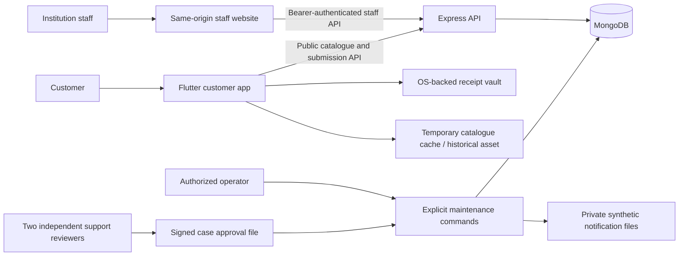

# System architecture

## Runtime components

The notification transport shown above is local only. There is no implemented connection from the platform to a bank core system, email/SMS provider or payment system. A production HTTPS gateway is a deployment responsibility, not a provisioned component in this repository.

## Backend composition

[app.js](../../Backend/app.js) builds Express without opening a socket. It disables the framework header, serves the staff assets with restrictive browser headers, limits JSON bodies to 16 KB, mounts routes and returns a JSON 404 for unknown routes. [Server.js](../../Backend/Server.js) loads `.env`, waits for MongoDB and enquiry index readiness, then listens on `PORT` (default 5000). Importing the app in tests does not start the normal server.

Requests pass through route-specific middleware and controllers. The enquiry validator normalizes the accepted fields and creates the request fingerprint; controllers resolve current catalogue selections and perform persistence. Staff middleware hashes the bearer token, uses constant-time hash comparisons and resolves an active institution before attaching a scoped identity. Controllers independently apply consent/institution predicates and project allowed fields. Error middleware maps malformed JSON, oversized bodies, validation/cast failures and unexpected errors to HTTP responses; internal server failures use a generic message.

The staff website is plain HTML/CSS/JavaScript served by this same Express origin. It has no separate SPA build server or authentication service. The browser's 15-minute idle handling clears its own session/data; **the bearer credential itself has no server-issued expiry** and stays usable until its binding is removed/changed or the institution is made inactive. Browser sign-out is not server-side token revocation.

## Mobile composition

The Flutter app uses imperative `Navigator` routes and local widget state; no account/session or central state-management framework is present. The repository separates catalogue networking/cache, submission/withdrawal transport and receipt persistence from the form widgets. [Mobile architecture](https://github.com/BlueZoft/EOApp-Mobile_Frontend/blob/main/docs/architecture/MOBILE_CLIENT.md) traces those classes and files.

`API_BASE_URL` is compiled into the app with `--dart-define`. The default is the Android emulator alias `http://10.0.2.2:5000`; the demo uses port 5100. The API client rejects URL credentials/query/fragment and remote plain HTTP, allowing HTTP only for configured local development hosts. This is a client guard, not a substitute for HTTPS enforcement on a deployed backend. The backend has no TLS listener, customer authentication or rate-limiting middleware in the current source.

## Persistence and transaction boundaries

MongoDB holds catalogue entities and enquiry documents. The enquiry uses the legacy `users` collection: it is not an account/user authentication table. Retry key and withdrawal-proof hash indexes are unique and sparse, preserving legacy records without those fields. The institution/branch/product public IDs are stable business identifiers separate from MongoDB `_id` values.

Enquiry creation and its consented notification entry are a **single document write**. Staff status plus audit history are a single conditional update. Withdrawal plus sharing revocation/queue cancellation are a single update. Retention replaces each eligible enquiry with a minimal tombstone using a guarded aggregation pipeline. There is no multi-document transaction requirement for those operations and no all-or-nothing rollback across a retention batch. A `find` followed by a guarded update is not itself a global transaction; the update predicates are what protect concurrent state changes.

Notification file acceptance and MongoDB acknowledgement cannot share an atomic commit. The worker uses leases and stable event IDs; the transport must deduplicate retries. Withdrawal can race a final delivery check, so events contain no applicant/contact data and never grant access to the staff record. Read the [notification runbook](../operations/NOTIFICATIONS.md) for the exact guarantees.

## Deployment and reset behavior

| Mode | API/data behavior | Lifecycle |
| --- | --- | --- |
| Normal development | `scripts/start-dev.sh` respects configured `MONGO_URI`/`.env`; otherwise uses `eoapp-dev-mongo`, host port 27018, database `eoapp` | Named Docker volume is reused; no automatic seed or purge |
| Synthetic demo | Separate loopback API, default 5100; fresh `eoapp_demo_<random-id>` database and temporary staff bindings | Graceful shutdown drops only its new session DB/files; forced termination may leave artifacts |
| Automated checks | Independent uniquely named test databases and ephemeral HTTP ports | Suites remove their synthetic databases; MongoDB must be available |
| Production | Endpoint, TLS gateway, MongoDB access, staff/reviewer trust and operations must be supplied | No hosted topology, scheduler, live bank adapter or environment policy is installed by the app |

Both normal startup and maintenance commands require deliberate configuration. API startup does not run notification processing, support recovery or retention. Files/scripts in Git survive environment recreation; processes, containers, SDK caches and shell exports may need restoring. A saved cloud setup draft or publication is distinct from the checked-in application and is not guaranteed by these documents.

## Source map

| Area | Primary implementation |
| --- | --- |
| Entry points / route mounting | [app](../../Backend/app.js), [server](../../Backend/Server.js), [routes](../../Backend/Routes) |
| Public enquiry validation and receipt | [validator](../../Backend/Validation/enquiry.js), [creation controller](../../Backend/Controllers/enquiryController.js) |
| Catalogue and legacy loans | [catalogue controller](../../Backend/Controllers/catalogueController.js), [loan controller](../../Backend/Controllers/loanController.js) |
| Staff access / casework | [auth](../../Backend/Middleware/staffAuth.js), [controller](../../Backend/Controllers/staffController.js), [browser](../../public/staff/staff.js) |
| Device withdrawal | [consent controller](../../Backend/Controllers/consentController.js) |
| Notifications | [worker](../../Backend/Services/notificationWorker.js), [local adapter](../../Backend/Services/localNotificationTransport.js) |
| Retention | [policy](../../Backend/Services/retentionPolicy.js), [report](../../Backend/Services/retentionPlan.js), [execution](../../Backend/Services/retentionExecution.js) |
| Support | [signature verification and withdrawal](../../Backend/Services/supportWithdrawal.js) |
| Local/CLI setup | [scripts](../../scripts), [demo runner](../../scripts/start-demo.js) |
| Automated evidence | [API/operations tests](../../test), [browser checks](../../browser), [CI definition](../../.github/workflows/ci.yml) |

Older compatibility exports/files and unused package dependencies can remain in the repositories. Their presence does not imply a routed feature; follow imports/routes from the entry points when extending the system.
