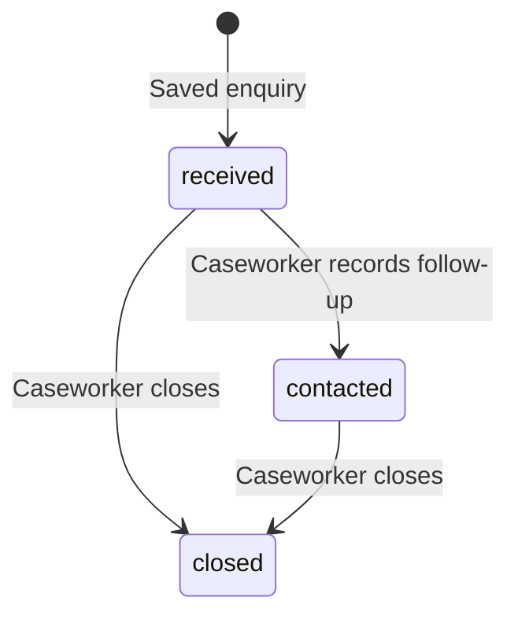

# End-to-end workflows

These flows describe the 1.6 implementation. Commands and payloads are detailed in the [API reference](../reference/API.md) and [operations runbooks](../operations/README.md). The states below belong to different concerns: an enquiry can be `closed` and still retained, or `received` and have sharing withdrawn.

## 1. Browse and select

The home arrow opens the category screen, which loads `/api/catalogue` with a 10-second timeout. A valid network response is authoritative even when empty. The app attempts to cache it; cache-write failure does not discard the network result. On network/format failure it tries a valid cache for the configured API base value, then the bundled historical asset. This supports browsing only; it does not queue offline form submissions.

Choosing a category filters the fetched products locally. An empty category displays an empty message. A scheme leads to its details and then an enquiry form carrying stable IDs and labels. The general path omits a product ID. Branch choices exclude known ownership mismatches but may include unassigned historical branches; the server independently checks selected active IDs on submission. Expired/deactivated IDs from an offline snapshot can require refresh before a new enquiry is accepted.

## 2. Submit and retry

```mermaid
sequenceDiagram
  participant C as Customer/form
  participant V as Device receipt vault
  participant A as Enquiry API
  participant D as MongoDB
  C->>V: Persist minimal pending receipt and random private proof
  alt Storage preparation fails
    V-->>C: Stop before sending; no plaintext fallback
  else Receipt persisted
    C->>A: Payload, proof hash and random Idempotency-Key
    A->>D: Find existing key; otherwise validate and create enquiry + optional queue entry
    D-->>A: Saved record or unique-key result
    A-->>C: 201 creation / 200 matching replay with original received receipt
    C->>V: Confirm reference locally
    C-->>C: Show storage acknowledgement
  end
```

The server validates syntax and any selected catalogue IDs, resolves canonical label snapshots and verifies the consent target. Explicit consent creates both consent metadata and a notification entry in the same enquiry write; private submissions do not enqueue work.

An unchanged in-screen retry uses the same key and proof. A timeout is **uncertain**, not proof of failure: the server may already have saved the request. A matching retry returns the same reference; changed normalized data under that key returns 409. A failed local reference-confirmation write leaves the earlier pending proof available. Full form data is not stored for editing/replay after an app restart. Editing the form creates a fresh submission identity; it does not revise the old enquiry.

Staff casework or withdrawal does not change the public submission receipt's `status: received`. A retained tombstone is different: matching keyed replay returns 410. The mobile form stops that expired retry. Only an explicit new-enquiry action resets the retry payload/consent; the next submission generates a new key/proof. No automatic resubmission restores sharing.

## 3. Institution follow-up



Only staff with a valid token for the active institution and matching recorded consent can see/update the record. Readers have no status authority. Updates include an expected current state; the backend atomically changes status and appends actor/date history. An identical target is idempotent; incompatible or stale transitions return 409. Closed records cannot be reopened through the staff API. Status actions do not send notifications, grant credit or expose the current state to “My enquiries.”

The browser defaults to **All statuses**, with Refresh/Newest/Older navigation. A concurrent update loads the current detail for review. A withdrawn/unavailable detail cannot be read; the browser refreshes its inbox after a detail 404. Access/configuration failure clears the browser session; there is no automatic live push of every withdrawal/status change.

## 4. Withdraw sharing

The customer opens “My enquiries,” chooses a device receipt and confirms withdrawal. The client sends the private token in a bearer header, without an enquiry body. The server hashes it, atomically sets sharing false and the first withdrawal date, cancels notification ownership, and returns only a minimal acknowledgement. Repeated requests preserve that date; a retained tombstone remains acknowledgeable. Staff APIs subsequently exclude the record.

A pending receipt can attempt withdrawal even if creation acknowledgement was lost. Unknown proof returns a generic 404; it may need retry if the original submission was delayed. Failed/unconfirmed withdrawal keeps the local proof. A completed withdrawal receipt can be removed from this device only; server retention is separate. There is no reference-only withdrawal, consent restoration, recall of prior views or deletion promise in this flow.

## 5. Notify through an explicit worker

```mermaid
stateDiagram-v2
  [*] --> pending: Consented creation
  pending --> processing: Atomic lease claim
  processing --> delivered: Transport acknowledgement under current lease
  processing --> pending: Retryable transport failure
  processing --> failed: Attempt limit
  processing --> processing: Reclaim expired lease
  pending --> cancelled: Withdrawal
  processing --> cancelled: Withdrawal or unavailable access
  delivered --> cancelled: Withdrawal; accepted file is not recalled
  failed --> cancelled: Withdrawal
```



The worker also cancels a claimed entry if its institution is inactive or its status is no longer received (including contacted/closed). Staff status changes do not synchronously cancel the queue; that check happens when the worker runs. Withdrawal immediately cancels ownership. There is no scheduled worker by default and old unqueued records are not backfilled.

Each event contains only IDs and generic content, never applicant details or access credentials. A 30-second lease and up to five send attempts bound processing; stable event IDs allow the transport to deduplicate an uncertain acknowledgement. An event may be accepted after the final consent check races withdrawal; it cannot authorize staff access. A late acknowledgement cannot reactivate cancelled/purged state. Only a private synthetic file transport is registered; a delivered local file is not bank delivery.

## 6. Lost proof / legacy support

Support verifies the requester's authority through an approved external process and records evidence outside the app. Two independent allowlisted reviewers sign the same enquiry/database/action/case/time payload. An operator explicitly enables the command, which verifies both Ed25519 signatures, distinct keys and the 24-hour validity window before atomically withdrawing sharing and recording a hidden minimal audit.

The reference alone gives no authority. The tool neither displays personal data nor issues a replacement device proof. Retry/concurrent execution preserves the first withdrawal date/audit. Human identity verification and reviewer appointment are not automated by a valid cryptographic signature. See [support recovery](../operations/SUPPORT_RECOVERY.md).

## 7. Retain and clear personal fields

An operator first runs the read-only aggregate report. Eligibility defaults to 180 days after the latest valid closure/withdrawal date; open non-withdrawn, held, undated closed and malformed-withdrawal records stay outside execution. The operator separately activates a bounded apply command and confirms the exact database name.

The executor selects at most 1000 candidates and rechecks current eligibility/hold conditions with each replacement. It removes personal/unknown fields and retains minimal retry/revocation tombstones. A newer withdrawal or hold after selection can postpone clearing. Batch failure may leave partial completion; rerunning skips tombstones. There is no automatic schedule, hard-delete/TTL of tombstones or backup-erasure job. Restore procedures must reapply later revocations/retention before enabling access. See [privacy lifecycle](../operations/PRIVACY_LIFECYCLE.md).

## Source checkpoints

These descriptions follow [creation](../../Backend/Controllers/enquiryController.js), [staff casework](../../Backend/Controllers/staffController.js), [withdrawal](../../Backend/Controllers/consentController.js), [notification worker](../../Backend/Services/notificationWorker.js), [support](../../Backend/Services/supportWithdrawal.js), [retention](../../Backend/Services/retentionExecution.js), and the companion [client architecture](https://github.com/BlueZoft/EOApp-Mobile_Frontend/blob/main/docs/architecture/MOBILE_CLIENT.md).
